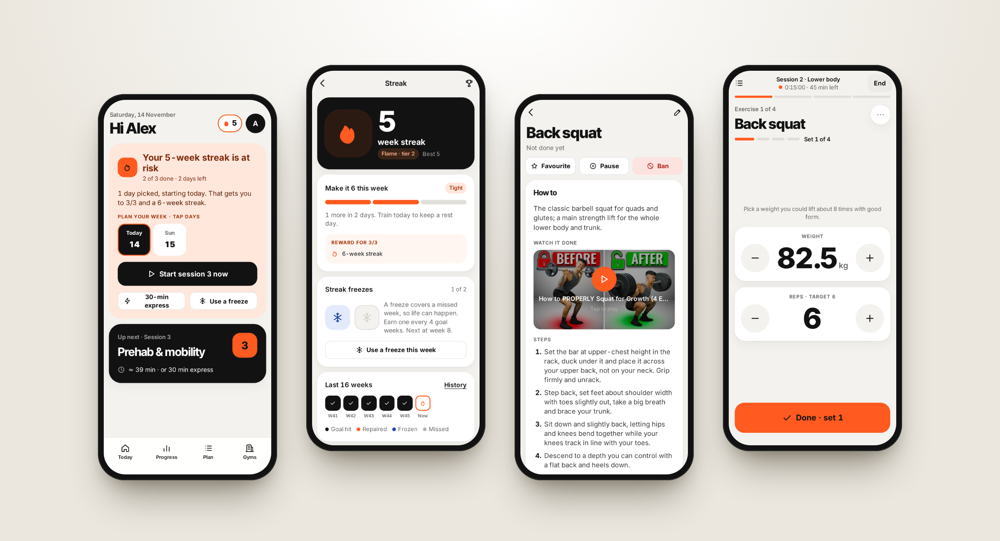
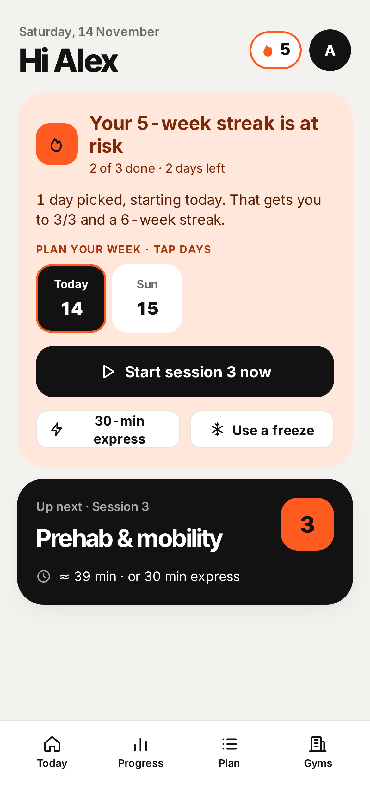
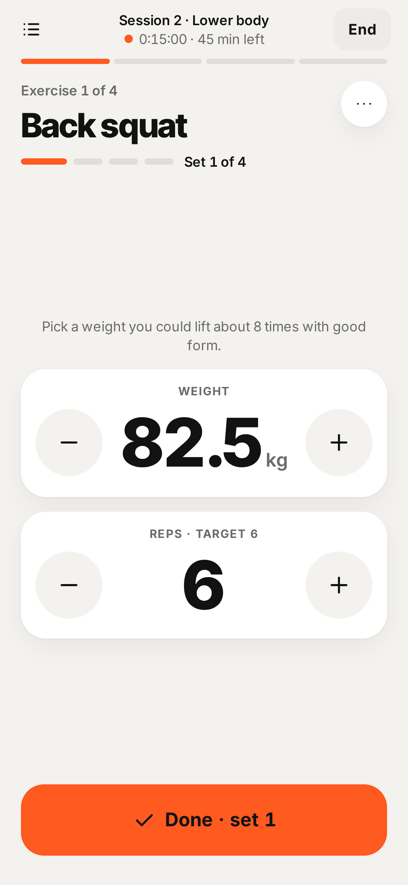
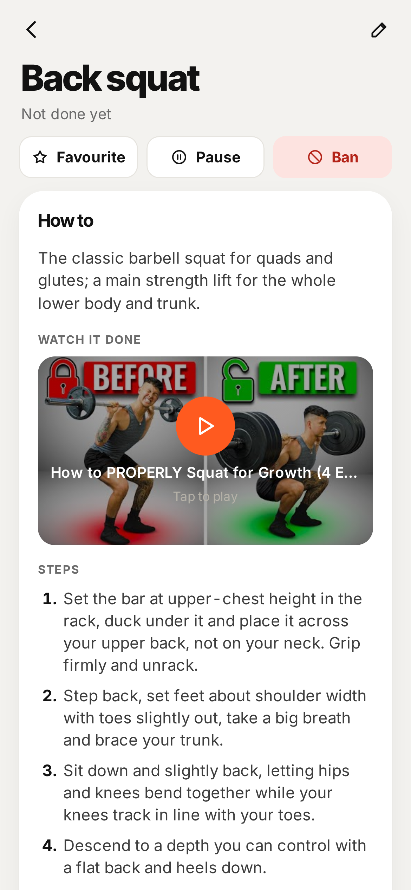
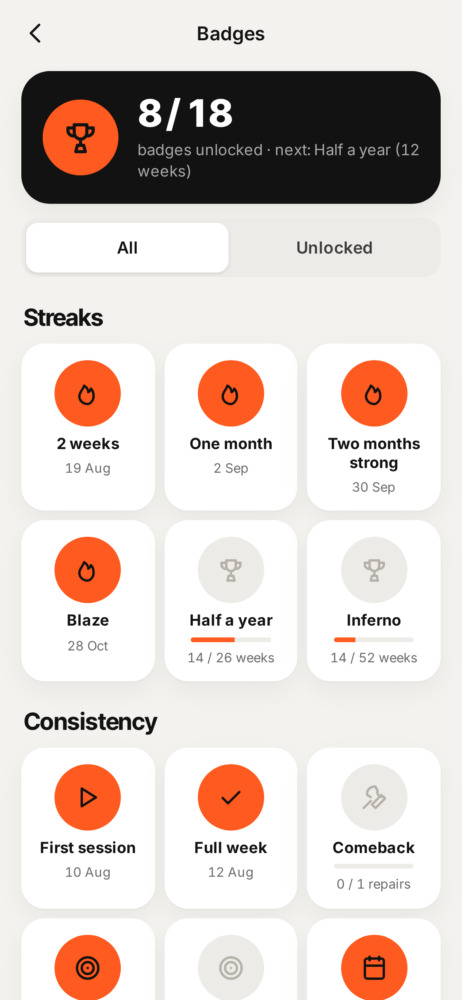
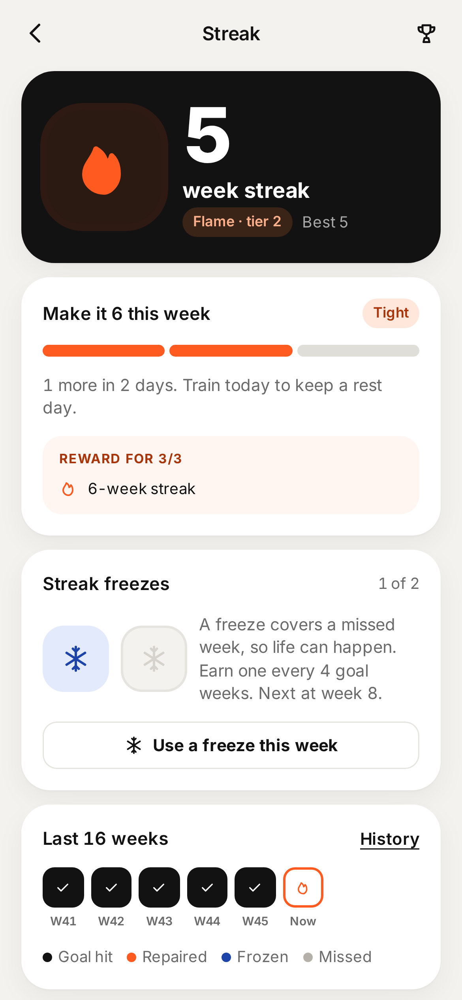
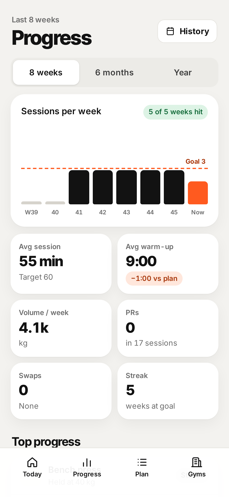
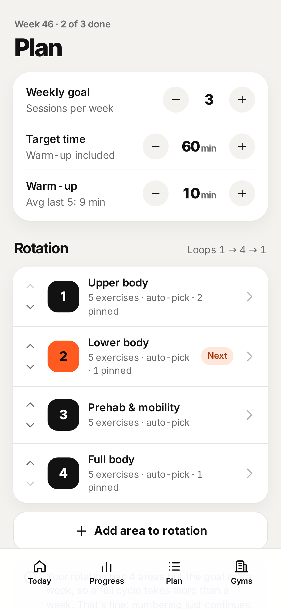
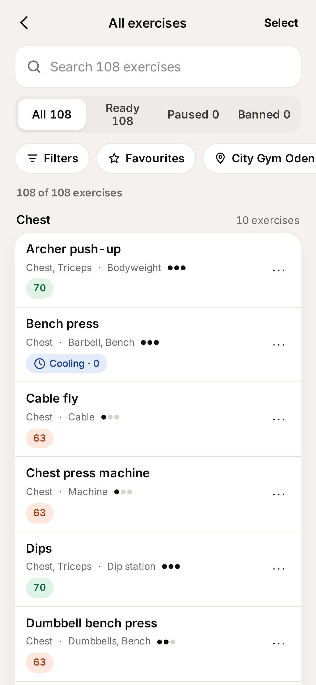

<div align="center">

# Rep

**A gym tracker that thinks in weeks, works without a signal, and takes direction from your AI coach.**

[**Open the app**](https://rep.ilmal.se/app/) &nbsp;·&nbsp; [Website](https://rep.ilmal.se) &nbsp;·&nbsp; [Connect a coach](#a-coach-that-can-actually-change-things) &nbsp;·&nbsp; [Run it yourself](#run-it)

<br>



</div>

<br>

Most trackers ask you to follow a calendar. Rep asks one question: *did you train enough this week?* You set a weekly goal, it
builds each session from your gym's equipment and your recent history, and it quietly keeps score so the next session is a little
better than the last. It installs to your home screen, works in a basement gym with no reception, and syncs when you're back online.

## What it does

**Train by the week, not the calendar**
Pick how many sessions a week you want. Sessions are built around body areas that rotate, so you never think about "what day is leg day".
A streak counts the weeks you hit your goal, with repairs and freezes so one rough week doesn't erase a good run.

**Knows where you are and what's there**
Add your gyms with the equipment each has. Rep matches your GPS to a gym, only suggests what you can actually do, and swaps an exercise
in one tap when a rack is taken. Training at home with nothing? There's a built-in no-equipment location with a bodyweight catalog.

**A planner that explains itself**
Every exercise is scored on relevance, recency, frequency and muscle coverage, with cooldowns and a variety penalty. You can see why
something was picked, favourite or ban lifts, and tune every weight. After each exercise you say whether the weight felt light, right or
heavy and the next session adjusts.

**Learn the lift before you do it**
All 108 exercises come with a summary, numbered steps, coaching cues, things to watch for, and a demo video that plays right in the app.
Edit any of it, or let your coach write the notes that matter to you.

**Pulse, if you want it**
Turn on heart rate and your iPhone sends readings from Apple Health (AirPods Pro or Apple Watch) in the background. You get a live pulse chip on the workout screen, zone colours, and average, max and min in every session summary. Outside workouts you choose how often a reading arrives. Your coach can read it too.

**Streaks that earn their keep**
Four tiers, milestone badges, streak freezes you earn every four goal weeks, a 30-minute express session when the week is slipping, and
reminders that stay quiet at night.

**Yours, and fast**
Offline-first: everything is written to the device first and synced in the background. A workout survives a dropped connection, a
reload, or the phone being killed mid-set.

<br>

<table>
  <tr>
    <td align="center" width="25%"><br><sub><b>Today</b><br>the week at a glance</sub></td>
    <td align="center" width="25%"><br><sub><b>Live session</b><br>big targets, one thumb</sub></td>
    <td align="center" width="25%"><br><sub><b>Exercise guides</b><br>steps, cues, video</sub></td>
    <td align="center" width="25%"><br><sub><b>Badges</b><br>milestones worth chasing</sub></td>
  </tr>
  <tr>
    <td align="center"><br><sub><b>Streak</b><br>pace, freezes, history</sub></td>
    <td align="center"><br><sub><b>Progress</b><br>what is actually improving</sub></td>
    <td align="center"><br><sub><b>Plan</b><br>areas, rotation, planner</sub></td>
    <td align="center"><br><sub><b>Library</b><br>everything, searchable</sub></td>
  </tr>
</table>

## A coach that can actually change things

Rep runs an [MCP](https://modelcontextprotocol.io) server at `/mcp`. Create a token under **Settings → Connect a coach** (read-only or
read & write) and point any MCP-capable agent at it. It can read your history, explain a score, preview the next session, rewrite your
plan, adjust planner weights, write exercise guides and attach videos, and use or undo a streak freeze, all of it landing in the same
sync stream as the app, so your phone picks the changes up on its own. More than 40 tools, listed [below](#connect-a-coach-agent-mcp).

## Built like it matters

- **Domain logic is pure and shared.** Planner, progression, streaks and sync rules are plain TypeScript in `src/shared`, used by the
  app and the server alike, so they cannot drift apart.
- **Streaks are derived, never stored.** The whole streak, freeze and badge state is recomputed by deterministic replay from your
  sessions and settings, which makes it testable to death (property tests included) and impossible to corrupt.
- **Tested hard.** ~1,000 unit and property tests, ~850 Playwright end-to-end tests run against the production build, and mutation
  testing on the streak and content engines (95% and 97% of mutants killed).
- **Small and boring where it counts.** One Bun process serves the landing site, the app, the API and MCP. SQLite in WAL mode, hourly
  verified backups copied off the machine, graceful shutdown, a queue for outgoing mail. See [docs/SCALING.md](docs/SCALING.md) for
  what scales, what doesn't, and the exact signal that says when to change it.

| | |
| --- | --- |
| App | React 19, React Router, Vite, a hand-rolled offline store (IndexedDB + outbox, last-write-wins sync) |
| PWA | Service worker with an update prompt, installable on iOS and Android, wake lock, app badge, web push |
| Server | Bun, Hono, `bun:sqlite`, streamable-HTTP MCP |
| Mail | Amazon SES over a hand-signed SigV4 request (no SDK), Resend as a fallback |
| Quality | `bun test`, Playwright, StrykerJS, fast-check |

## Run it

```bash
bun install
bun run dev:server      # API + MCP on :8787  (data in ./data/gym.db)
bun run dev:client      # Vite on :5173, proxies /api and /mcp
bun test src            # unit + property tests
bun run build && bun start   # production: the server also serves ./dist
```

Geolocation and installing the PWA need HTTPS (or `localhost`).
Docker: `docker build -t rep . && docker run -p 8787:8787 -v rep-data:/data rep`.

Optional environment (all unset by default, nothing is required to run locally):

| Variable | Purpose |
| --- | --- |
| `PUBLIC_URL` | Public origin, used in sign-in links and the push subject |
| `SES_ACCESS_KEY_ID`, `SES_SECRET_ACCESS_KEY`, `SES_REGION` | Send sign-in email through Amazon SES |
| `RESEND_API_KEY` | Or send it through Resend |
| `MAIL_FROM` | Sender, e.g. `Rep <login@your-domain>` |
| `GYM_DB` | SQLite path (default `./data/gym.db`) |

Without a mail provider the sign-in link is printed to the server log in development. There are Kubernetes manifests, a smoke test and a
backup restore drill in [`deploy/`](deploy), and the hardening notes live in [`docs/SCALING.md`](docs/SCALING.md).

## Architecture

- `src/shared` — pure domain code (incl. `content.ts` how-to content: limits, media URL detection, sanitising, merged view; `exercise-content.ts` built-in text) used by the client AND the server: types, equipment catalog, exercise library, `rules.ts`
  (progression, auto-adjust, hot-swap scoring, week counter, rotation pointer, geo), `planner.ts` (exercise scoring + session generation).
- `src/server` — Hono on Bun. `api.ts` (anonymous device accounts, optional email+password, push/pull sync with last-write-wins per entity,
  export/delete, API tokens), `mcp.ts` (MCP over streamable HTTP), `store.ts` (entity access). SQLite via `bun:sqlite`.
- `src/client` — React + react-router. `store/` is an offline-first store persisted to IndexedDB with an outbox that syncs when online.
  All timers derive from wall-clock timestamps and the in-progress session is persisted, so a reload or kill resumes cleanly.


## Scoring (what the planner does)

Every exercise gets a 0–100 score on each planning run:

`(wRelevance·relevance + wRecency·recency + wFrequency·frequency + wCoverage·muscleCoverage + wFavorite·favorite) / Σw`, minus 40 while cooling down.

- **relevance** (0–100): yours / your coach's rating of how relevant the exercise is to the current plan.
- **recency**: rises the longer since you did it; 0 while cooling down (not repeated within `cooldownSessions` sessions or `minDaysBetween` days).
- **frequency**: favours exercises you've done less within the window.
- **coverage**: favours exercises whose muscles are overdue (and that fit the area's focus).

Selection is greedy with a variety penalty, so similar-but-different exercises rotate in instead of the same lift twice.
`avoid` excludes an exercise from auto-picks; pinned exercises are always included. Every knob is in Settings → Planner and editable over MCP.

## Streaks and rewards
Streak = consecutive Mon-Sun weeks that count (hit, repaired, frozen); repair a week missed by 1-2 next week, earn a freeze per 4 weeks (max 2), tiers and 18 badges.
All of it is derived from sessions + settings by `src/shared/streak.ts` (API documented at its top; rules and states in `docs/STATES.md` 3.1), so the app, MCP (`get_streak`) and push reminders agree.

## Connect a coach agent (MCP)

In the app: **Settings → Connect a coach** → create a token (read-only or read & write). Server URL: `https://<your-host>/mcp`
(streamable HTTP, JSON responses, `Authorization: Bearer rep_…`). For a client that takes a URL plus an auth header:

```json
{ "type": "url", "url": "https://<your-host>/mcp", "authorization": "Bearer rep_XXXXXXXX" }
```

Smoke test:

```bash
curl -s https://<host>/mcp -H 'authorization: Bearer rep_…' -H 'content-type: application/json' \
  -d '{"jsonrpc":"2.0","id":1,"method":"tools/call","params":{"name":"get_overview","arguments":{}}}'
```

Exercise guides: every exercise (built-in and custom) has how-to content: summary, ordered steps, coaching cues, good-to-know tips and images/videos. Built-ins ship written text plus one demo video that plays inside the app; your own edits and your coach's are stored as an override on the exercise's pref, win per field, and sync like any other preference (see `docs/STATES.md` 1.5.1). The athlete reads it on the exercise page, from "How to do it" on the live "Up next" screen and from the info button in the pre-session list. Over MCP: `get_exercise` / `list_exercises` return the merged content (`content.customised` says which fields are yours; `missingUserContent` finds undocumented exercises), `set_exercise_content` (replace or merge steps/cues/tips/summary), `add_exercise_media` (https image, video file, YouTube/Vimeo link; kind auto-detected), `remove_exercise_media`, `reset_exercise_content`, plus content fields on `create_exercise`/`update_exercise`. The coach is told to write the most important parts the athlete should read before performing the exercise; media URLs must be https and are never invented. The server sets a CSP on `/app/*` allowing images/video over https and YouTube-nocookie / Vimeo embeds only (the player loads after a tap).

Read tools: `get_overview` `list_sessions` `get_session` `get_exercise_history` `list_exercises` `get_exercise` `explain_score` `list_areas` `list_gyms`
`list_equipment_catalog` `get_settings` `get_muscle_report` `get_stats` `get_streak` `get_heart_rate` `get_session_heart_rate` `preview_next_session` `list_coach_plans` `list_events` `export_all`.

Write tools: `create_exercise` `update_exercise` `archive_exercise` `set_exercise_pref` `set_exercise_content` `add_exercise_media` `remove_exercise_media` `reset_exercise_content` `bulk_set_exercise_prefs` `set_next_prescription` `create_area` `update_area`
`delete_area` `set_rotation` `update_settings` (incl. planner weights and profile notes) `reset_planner` `use_streak_freeze` `undo_streak_freeze` `update_gym_equipment` `create_coach_plan` `cancel_coach_plan` `add_session_note`.

The built-in location `gymId: "none"` ("At home, no equipment": bodyweight, floor, wall) is always available and not a stored gym: `preview_next_session` and `list_exercises` (`availableAtGymId`) accept it, sessions there read `gym: "No equipment"`, and `update_gym_equipment` refuses it.

Writes land in the same sync stream as the app, so the phone picks them up within about a minute (or on next open).

## Data & privacy

Anonymous device account by default; optionally add email+password to restore on another device. Export and delete live in Settings.
API tokens are stored hashed; passwords use argon2id (`Bun.password`).

---

<div align="center"><sub>Made for lifting heavy things on a schedule that survives real life. &nbsp;·&nbsp; <a href="https://rep.ilmal.se">rep.ilmal.se</a></sub></div>
